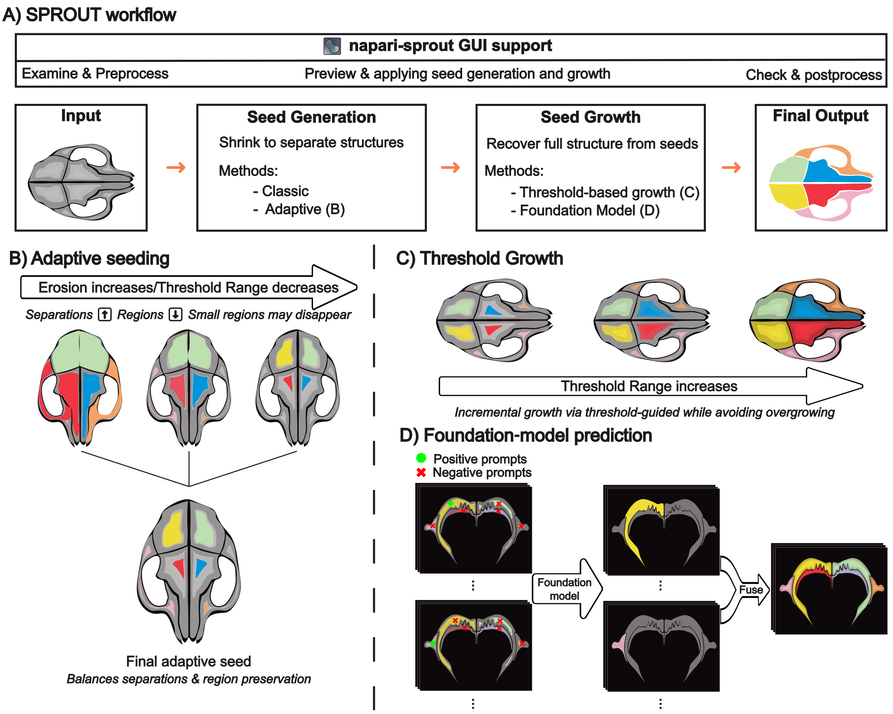
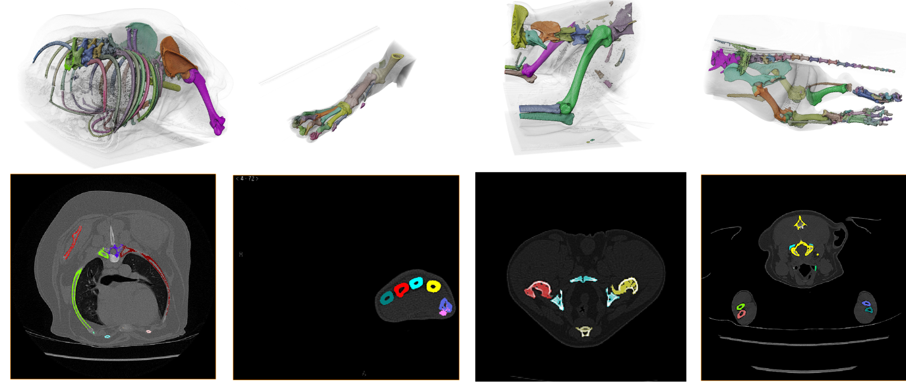
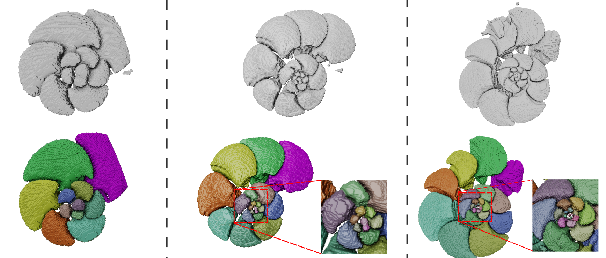
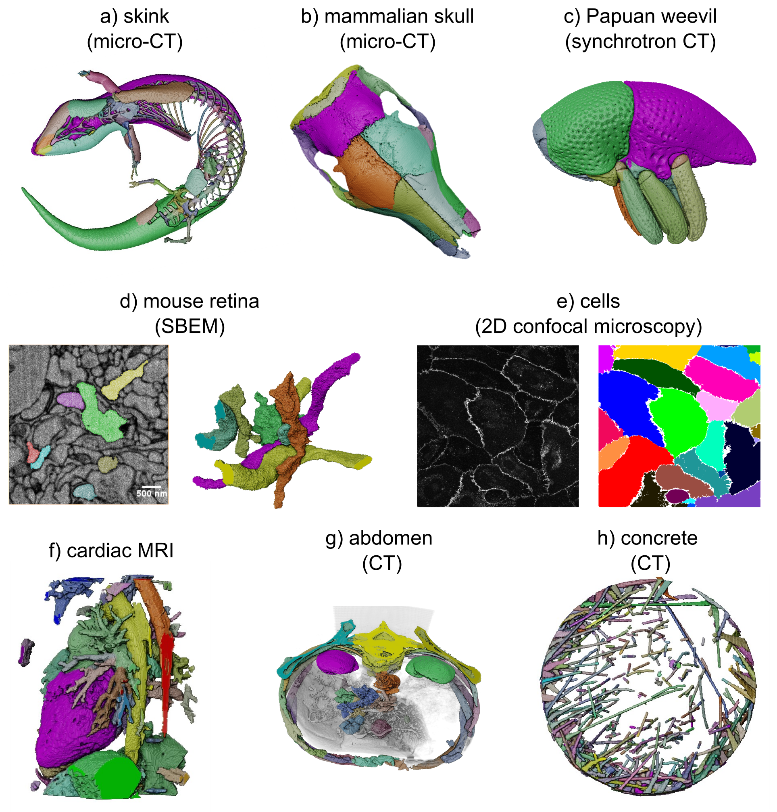

# SPROUT

[](https://pypi.org/project/napari-sprout/)
[](https://github.com/EchanHe/SPROUT/actions/workflows/tests.yml)
[](LICENSE)

## TL;DR 
SPROUT is a lightweight segmentation toolkit for fine-grained and multi-part segmentation of grayscale 2D/3D images.

```bash
pip install "napari-sprout[all]"     # then start napari: Plugins → SPROUT
```

More ways to install: [Install](#install).

👉 Quickstart: [Quickstart with Demo Data](./docs/demo_data_tutorial.md)

Video demo — Getting started with GUI-supported SPROUT using napari:
<a href="https://www.youtube.com/watch?v=6rA7wW6f0SU" target="_blank">
  
</a>

Click [here](https://www.youtube.com/watch?v=4DHI1gs1lzc&list=PL8tsvVKJ9n6FjYYplo-IAwKBLxDh578aj) for the playlist of all SPROUT videos (mainly focus on GUI-based SPROUT in napari). See [Usage](#️-usage) section for command-line usage.

---

- [Introduction](#introduction)
- [Install](#install)
- [Usage](#️-usage)
   - [Terms](#terms)
   - [Input Data Format](#input-data-format)
   - [Quickstart with Demo Data](#quickstart-with-demo-data)
   - [Seed Generation](#-run-seed-generation)
   - [Adaptive Seed Generation](#-run-adaptive-seed-generation)
   - [Sweep Adaptive Seed](#-run-sweep-adaptive-seed)
   - [Growth](#-run-growth)
   - [External Model Prediction](#-external-model-prediction)
- [View & Edit (napari)](#view--edit-napari)
- [Demo Results](#demo-results)
- [Related tools](#related-tools)
- [Extras](#extra-features)

## Introduction

**SPROUT (Semi-automated Parcellation of Region Outputs Using Thresholding and Transformation)**  
SPROUT is an interpretable workflow for semi-automated, multi-class segmentation of volumetric images (e.g., CT, MRI). It requires no training data and is designed for researchers facing challenging segmentation tasks, such as structures with fine details or weak boundaries, where data for deep learning is scarce. 
  
**Y. He, M. Camaiti, L.E. Roberts, J.M. Mulqueeney, E. Ioannou, M. Didziokas, A. Goswami. 2024.**  
[*SPROUT: A User-friendly, Scalable Toolkit for Multi-class Segmentation of Volumetric Images*](https://www.biorxiv.org/content/10.1101/2024.11.22.624847v2.abstract)  


## Install

SPROUT needs Python 3.10 or newer. We recommend a conda environment ([Miniforge](https://conda-forge.org/download/)):

```bash
conda create -n sprout python=3.12
conda activate sprout
pip install "napari-sprout[all]"     # SPROUT, the napari plugin, napari and Qt
```

Then start napari (`napari`) and open **Plugins → SPROUT**. The `sprout` command is installed too.

Other ways:

| You want | Run |
|---|---|
| Only the command line (e.g. on a cluster, no napari) | `pip install sprout-seg` |
| The plugin, napari already installed | `pip install napari-sprout` |
| nnInteractive (Prompt (AI) tab, `sprout --prompt --nninteractive`) | `pip install "sprout-seg[ai]"`. With an NVIDIA GPU, first install PyTorch for your CUDA version ([pytorch.org](https://pytorch.org/get-started/locally/)). |
| Meshes (`make_mesh`) | `pip install "sprout-seg[mesh]"` |
| SAM | see [External Models](docs/external_model_installation.md#sam-segment-anything-model) |
| To change the code | `git clone https://github.com/EchanHe/SPROUT.git`, `cd SPROUT`, `pip install -e . -e ./napari-sprout` |

The paper's results were made with Python 3.10, numpy 1.26.4, pandas 2.2.1, scikit-image 0.22.0, scipy 1.15.3, tifffile 2024.2.12, napari 0.6.1. The tests run on these versions and on the newest ones.


## ⚙️ Usage

SPROUT follows a **two-step workflow** for multi-class segmentation:




1. **Seed Generation**  
   The goal of this step is to reduce the regions of the image by breaking it into multiple distinct components (splits). There are two strategies:
   
   - [**Vanilla seed generation**](#-run-seed-generation): generate multiple seeds by varying configurations such as thresholds and erosion steps.
   - [**Adaptive seed generation**](#-run-adaptive-seed-generation): automatically combine information across seeds from different configurations to produce a often better and final seed.
   - [**Sweep adaptive seed**](#-run-sweep-adaptive-seed): make one seed per threshold, then combine them all. It has no early stop and stays fast with many seeds.
2. **Seed Growth**  
   - [**Threshold-based growth**](#-run-growth): grows a seed by expanding the reduced components back toward their full target shapes. Growth is guided by image intensity and connectivity.
   - [**Sprout+External**](#-external-model-prediction): seeds are converted into prompts for a segmentation foundation model such as SAM & nnInteractive, which then predicts the segmentation. nnInteractive works in 3D; SAM predicts slice by slice, and the slices are fused into a 3D output.

**🧪 Interactive Inspection & Editing**

In practice, both seed and grow results often require **visualisation, quality checking, or manual editing**, depending on your segmentation goals.

To support this, SPROUT is fully integrated into the **Napari** ecosystem as a plugin, please see [napari-sprout](#view--edit-napari). 

**Command line:** the examples below use `python sprout.py` in a clone of this repository. After `pip install`, `sprout` does the same from any folder, e.g. `sprout --seeds --config my_seeds.yaml`.

### Terms

The same words are used in the code, the YAML configs, the napari plugin and the paper.

| Term | Meaning |
|---|---|
| **segmentation** | A label map: each voxel holds an integer id, 0 is background. In napari it is a *Labels layer*. Seeds and the results of growth and of interactive models are all segmentations. |
| **seed** / **seeds** | A segmentation made by seed generation, where structures are shrunk apart by thresholds and erosion. Seeds are the input of growth. |
| **region** | The voxels that share one id. A region has an id but no meaning yet: the id is just a number, and regions can be split, merged or removed. |
| **class** | A semantic category, e.g. *head* or *femur*. Class mapping assigns regions to classes; the id of a class is its *class id*. Interactive models (nnInteractive) segment one class at a time, so map the seeds to classes first. |
| **step** | One threshold or erosion setting of a sweep adaptive seed run. Each step gives one mask, in `steps/`. |
| **segments** | The parameter "keep the N largest regions" (`segments`; adaptive seed also has `init_segments` and `last_segments` for its first and last step). It never means a region itself. |
| **grown segmentation** | The result of growth ("Grow result" in napari); likewise the *nnInteractive segmentation* ("Prompt result"). |


### **Input Data Format**
SPROUT processes 2D and 3D grayscale images stored in **TIFF (`.tif`, `.tiff`) format**. 

- **Supported file types:** `.tif`, `.tiff`
- **Image Type:** 2D or 3D grayscale images
- **Bit Depth:** 8-bit, 16-bit, or 32-bit (floating point)
- **File Structure:**  
   - 2D images: `(Height, Width)`
   - 3D images: `(Depth, Height, Width)`

**Unsupported inputs:** Color images.

### Quickstart with Demo Data

See [Demo Data and Basic Usage](docs/demo_data_tutorial.md) for a quick start.

See [Scenarios](docs/scenarios.md) for advance usage in a Q&A style.   

`./demo_data` includes a **dog skeleton** `dog_img.tif`, a **foraminifera chamber segmentation** `foram_img.tif` and a **2D cell microscopy image** `2d_cell.tif`. Their corresponding seed images are also provided in the same directory. 

Additional demo data can be found [here](https://zenodo.org/records/16857648).

### 🌰 Run seed generation

**on a single image**
```bash
python sprout.py --seeds --config path/to/seed_config.yaml
```
**in batch mode**
```bash
python sprout.py --seeds --batch --config path/to/batch_seed.yaml
```

A video explain batch mode: [link](https://www.youtube.com/watch?v=5o-PJ34Yirc)

For full details on YAML parameters and other configs see:
- [Seed configuration options](./docs/config_seed.md)

For example, see the YAML configuration files in `./template/`.

### 🧠 Run Adaptive Seed Generation

**on a single image**
```bash
python sprout.py --adaptive_seed --config path/to/adaptive_seed_config.yaml
```

**in batch mode**

```bash
python sprout.py --adaptive_seed --batch --config path/to/batch_adaptive_seed.yaml
```

For full details on YAML parameters and other configs see:

-   [Adaptive seed configuration options](./docs/config_adaptive_seed.md)
    

For example, see the YAML configuration files in `./template/`.

### 🌊 Run Sweep Adaptive Seed

**on a single image**
```bash
python sprout.py --sweep_adaptive --config ./template/sweep_adaptive_seed.yaml
```

**in batch mode**

```bash
python sprout.py --sweep_adaptive --batch --config path/to/batch_sweep_adaptive_seed.yaml
```

The seeds are in `FINAL_sweep_seed.tif`, and `sweep_regions.csv` tells where each seed comes from. For large scans, `memory_limit_gb` caps the memory.

For the parameters, the output, and how to choose between this and adaptive seed see:

-   [Sweep adaptive seed configuration options](./docs/config_sweep_adaptive_seed.md)

### 🌱 Run Growth

**on a single image**
```bash
python sprout.py --grow --config path/to/grow_config.yaml
```
**in batch mode**
```bash
python sprout.py --grow --batch --config path/to/batch_grow.yaml
```

For full details on YAML parameters and other configs see:
- [Growth configuration options](./docs/config_grow.md)

For example, see the YAML configuration files in `./template/`.

### 🧠 External Model Prediction
**Using SPROUT seeds as prompts:**
Prompts extracted from SPROUT seeds (e.g., point coordinates, bounding boxes) can be used as inputs for external models like SAM-based methods and nnInteractive. See [Foundation Model configuration options](./docs/config_sam.md) for details.

**on a single image or a folder of images**
 - SAM-based
```bash
python sprout.py --prompt --sam --config path/to/config.yaml
```
 - nnInteractive
```bash
python sprout.py --prompt --nninteractive --config path/to/config.yaml
```


**in batch mode**
 - SAM-based
```bash
python sprout.py --prompt --sam --batch --config path/to/config.yaml
```
 - nnInteractive
```bash
python sprout.py --prompt --nninteractive --batch --config path/to/config.yaml
```

For full details on YAML parameters and other configs see:
- [Foundation Model configuration options](./docs/config_sam.md)

For example, see the YAML configuration files in `./template/`.

### ⚡ Parallelization Support

`sprout.py` can run tasks in parallel using Python’s `threading`. Just set `num_threads` in your config to speed up processing, especially for large datasets.


## View & Edit (napari)

🎥 **Tutorial Video — Editing Segmentation Results in napari-SPROUT**  
<a href="https://www.youtube.com/watch?v=H9pLkmy6WwA" target="_blank">
  
</a>

To launch **napari-sprout**:

1. Start napari by running `napari` in a terminal or command prompt.
2. Open the `napari-sprout` plugin from the napari menu: Plugins → SPROUT.

From here, you can use a set of tools to load, view, and edit your data.  

-   **SPROUT**: tabs for the whole pipeline. Parameters match the YAML configs (Import / Export YAML).
    -   **1. Seeds**: seed and adaptive seed generation.
    -   **2. Grow**: grow seeds into a segmentation.
    -   **3. Prompt (AI)**: seeds as prompts for nnInteractive ([install](#-external-model-prediction)).
    -   **ROI & Boundary**: run a tab inside a region of interest; make a boundary mask (top-hat).
-   **Edit**: keep or remove regions (Ctrl+click), replace ids, merge layers, split, filter, fill holes, morphology.
-   **Label Mapping**: map regions to classes, e.g. `1 → bone_1`, `2 → bone_2`.
-   **Batch Builder**: batch CSVs, optionally with per-image thresholds (e.g. Otsu); reference shapes.
-   **Data Info**: shape, value range, label count and sizes of the selected layer.


In addition to `napari-sprout`, **napari** also provides powerful editing options (e.g. **Brush** to add regions, **Erase** to remove).


You can also visualize, inspect, and edit seeds or results using 3D image processing tools such as **3D Slicer**, **Dragonfly**, and **AVIZO**. Alternatively, you can generate meshes and view or edit them in mesh-based tools like **MeshLab**. See [Extra section](#extra-features)


## Demo Results

Batch processing results of segmenting dog bones in CT scans with varying anatomy and postures.



Batch processing results of segmenting foram binary segmentation (supports segmentation masks as input too) with variable numbers of chambers


Gallery of other results



_Note: All results underwent manual post-processing primarily to verify and correct segmentation errors._


## Related tools

- [nnInteractive](https://github.com/MIC-DKFZ/nnInteractive): 3D interactive segmentation from points, scribbles, boxes and lassos. SPROUT seeds can be its prompts (Prompt (AI) tab).
- [SAM](https://github.com/facebookresearch/segment-anything) / [SAM 2](https://github.com/facebookresearch/sam2): promptable segmentation of 2D images. SPROUT seeds can be its prompts.
- [Biomedisa](https://biomedisa.info): fills in a 3D segmentation from a few labelled slices.
- [nnU-Net](https://github.com/MIC-DKFZ/nnUNet): accurate supervised segmentation when training labels exist; corrected SPROUT results can be its training labels.
- [BounTI](https://pubmed.ncbi.nlm.nih.gov/38760955/): boundary-preserving threshold iteration, which inspired SPROUT (M. Didziokas, E. Pauws, L. Kölby, R. H. Khonsari, M. Moazen. 2024. *Journal of Anatomy* 245, 829–841).

----------
## Extra Features

### Other Optional Tools
You can use other tools to visualize and edit SPROUT's segmentation results, see [Optional Tools](./docs/supplementary_extra_plugins.md) for details.

### Helper Functions
In napari-sprout and plugins, we provided GUI version of editing results. You can also find the script-version in [Helper Functions](./docs/supplementary_helper.md).

### BounTI Multithreaded Implementation

The script `./BounTI/run_bounti_mp.py` is designed to run **BounTI** ([Related tools](#related-tools)) and **BounTI Flood** using a multithreaded approach. It efficiently processes a list of initial thresholds in parallel, leveraging multiple threads for improved performance.


